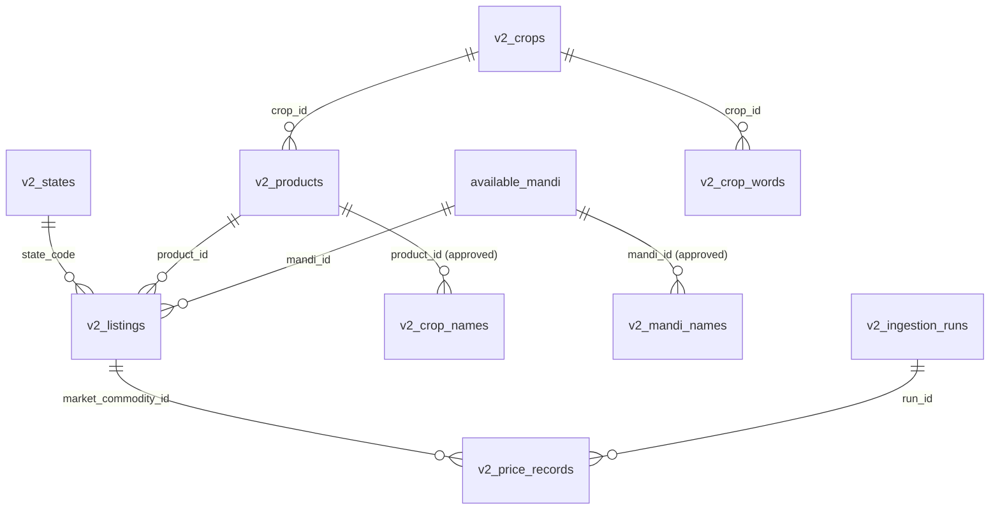

# Mandi v2 — Database design

MongoDB. v2 lives in the **same database as v1**; every v2 collection has the prefix `v2_`
(env `V2_COLLECTION_PREFIX`). v1 collections are never written. `available_mandi` is shared:
v2 reads it in place and never changes it.

Source of truth in code: `database.py` (listings, prices), `catalog.py` (name links),
`review_log.py` (runs, review items), `maintenance/migrate_v2.py` (how it was built),
`maintenance/seed_crop_words.py` (farmer words), `maintenance/lookup_market/add_market.py` (mandis).

## 1. The idea in one paragraph

The scraper never decides what a name means. Each source spells crops and mandis differently
("Onion", "ONION - Red", "Dry Chillies"). The scraper looks every raw name up in a table of
**person-approved links** (`crop_names`, `mandi_names`). An approved link gives the listing a
`product_id` / `mandi_id`; an unknown name is stored as **pending** for a reviewer. Anything not
approved gets `null` ids, so it is invisible to farmers. Links are re-read on every run, so a
rejection or change takes effect on the next scrape.

## 2. Overview

| Group | Collections |
|---|---|
| Facts (what the scraper writes every run) | `v2_listings`, `v2_price_records` |
| Reference data | `v2_states`, `v2_crops`, `v2_products`, `available_mandi` (shared with v1) |
| Name links (human-approved) | `v2_crop_names`, `v2_mandi_names`, `v2_crop_words` |
| Operations / review | `v2_ingestion_runs`, `v2_review_items`, `v2_audit_log`, `v2_migration_info` |

## 3. Fact collections

### `v2_listings` — one row per mandi + crop + variety
Same `_id`s as v1 `markets_commodities` (so old references still resolve).

| Field | Type | Notes |
|---|---|---|
| `_id` | ObjectId | |
| `source_system` | string | Which scraper (agmarknet, karnataka, …). Lower-cased. |
| `state` | string | Raw state text from the source. |
| `market_name` | string | Raw mandi name. |
| `commodity_group`, `commodity_name`, `variety`, `grade` | string | Raw crop text. |
| `source_url`, `source_name`, `method` | string | Provenance. |
| `state_code` | string \| null | → `v2_states._id`. |
| `product_id` | ObjectId \| null | → `v2_products._id`. **Null until the crop link is approved.** |
| `mandi_id` | ObjectId \| null | → `available_mandi._id`. **Null until the mandi link is approved.** |
| `first_seen`, `last_seen` | date | `last_seen` is refreshed on every run. |
| `legacy` | object | `{commodity_alias_lookup_id, market_id}` — old v1 ids, kept for traceability. |

Indexes: unique `unique_market_commodity` on (`source_system`, `state`, `market_name`, `commodity_name`, `variety`);
`idx_listing_product_mandi` (`product_id`, `mandi_id`); `idx_listing_mandi`; `idx_listing_state_code`; `idx_mc_state`; `idx_mc_commodity`.

### `v2_price_records` — one row per listing per date (time series)

| Field | Type | Notes |
|---|---|---|
| `market_commodity_id` | ObjectId | → `v2_listings._id` |
| `date` | date/string | Trading date. Future dates are rejected/repaired by the scraper. |
| `min_price`, `max_price`, `modal_price` | number \| null | Rs per `v2_products.price_unit` (normally Rs/quintal). A row with all three null is never stored. |
| `arrival_quantity` | number \| null | |
| `run_id` | string | → `v2_ingestion_runs.run_id` |
| `ingested_at` | ISO string | |

Indexes: unique `unique_price_entry` (`market_commodity_id`, `date`) — re-scraping a day updates, never duplicates;
`idx_pr_date`; `idx_pr_mc_id`.

## 4. Reference collections

### `v2_states`
`{ _id: "karnataka" (state code), name, spellings: [every spelling seen], lgd_code }`
Index: `spellings`. Used to turn any raw state text into a `state_code`.

### `v2_crops` / `v2_products`
A **crop** is the plant ("Onion"). A **product** is a priced form of it ("Onion, raw, Rs/quintal").
Prices and links point at the product, so a future "dried onion" can be added without touching history.

| `v2_crops` | |
|---|---|
| `name` (unique), `category`, `crop_master_id`, `default_product_id`, `active`, `legacy_group_ids`, `created_at`, `updated_at` |

| `v2_products` | |
|---|---|
| `crop_id`, `name`, `form` (e.g. "raw"), `price_unit` (e.g. "Rs/quintal"), `active`, `legacy_group_ids`, `created_at`, `updated_at` |

Unique index on (`crop_id`, `name`).

### `available_mandi` (shared with v1, read-only for v2)
The approved list of mandis with location.

| Field | Notes |
|---|---|
| `_id` | = `mandi_id` used everywhere in v2 |
| `name`, `aliases[]`, `state`, `district`, `postcode` | |
| `location` | GeoJSON Point, `coordinates: [lng, lat]`, **2dsphere index** `idx_location_2dsphere` |
| `createdAt`, `updatedAt` | |

This is the collection a "nearest mandi" query runs against.

## 5. Name-link collections (the review workflow)

All three have the same lifecycle: `status` = `pending` → `approved` | `rejected`.
Only `approved` links return an id. They also share: `suggestion`, `decided_by`, `decided_at`,
`needs_check`, `notes`, `first_seen`/`last_seen` (or `created_at`).

### `v2_crop_names` — source crop text → product
Key: (`source`, `raw_name`, `raw_variety`), where `raw_variety = "*"` means any variety.

`{ source, raw_name, raw_variety, product_id|null, status, suggestion, decided_by, decided_at, needs_check, notes, listings, first_seen, last_seen, records_last_run }`

### `v2_mandi_names` — source mandi text → mandi
Key: (`source`, `state_code`, `raw_name`).

`{ source, state_code, raw_name, mandi_id|null, status, suggestion, decided_by, decided_at, needs_check, notes, listings, first_seen, last_seen, records_last_run }`

### `v2_crop_words` — English farmer words → crop
Other English names for a crop ("dry chillies", "blackgram"). Read by the price tool, not by the scraper.
English only (farmer questions arrive already translated).

`{ key (unique, order-insensitive word key), word, crop_id|null, product_id|null, status, suggestion, sources[], decided_by, decided_at, needs_check, notes, created_at }`

Field meanings:
- `suggestion` — for pending rows, the best guess and why it was not auto-approved (`{product_id, product_name, reason}`).
- `decided_by` — `"migration"` / `"seed"` for auto-approvals from v1; a person's id for reviewer decisions.
- `needs_check: true` — approved automatically; a person should still confirm.
- `listings` — how many listings use this name (review the biggest first).

## 6. Operations collections

| Collection | One document per | Purpose |
|---|---|---|
| `v2_ingestion_runs` | source per run, plus one `_pipeline` summary | `run_id`, `source`, `success`, `error`, `started_at`, `finished_at`, `records_fetched`, `records_normalised`, per-state counts, unmatched counts. Basis for "last successful scrape". Indexes: `started_at` desc; (`source`, `started_at`); `run_id`. |
| `v2_review_items` | problem (keyed, so repeats update one item) | Types: `run_failed`, `unknown_state`, `price_invalid` (min > max, modal outside range, price ≤ 0). Capped at 500 price items per run. |
| `v2_audit_log` | reviewer action | Index `at` desc. |
| `v2_migration_info` | migration | Records the v1 source, time, and how many links were auto-approved vs pending. |

## 7. How a scrape run flows

1. Scrapers produce normalised documents.
2. `Catalog` loads states / crop links / mandi links into memory once.
3. For each document: upsert the **listing** (identity fields set once; `state_code`, `product_id`, `mandi_id`, `last_seen` refreshed every run from approved links).
4. Upsert the **price** for (listing, date).
5. New unseen names are inserted as **pending** in `crop_names` / `mandi_names`; `last_seen` is refreshed on those seen.
6. `review_log` writes the run summary and any review items.

## 8. Reading data correctly (rules for anyone building on this)

- Only trust listings where `product_id` **and** `mandi_id` are non-null. Everything else is unreviewed.
- Prices are per `v2_products.price_unit`; do not assume the unit.
- Always expose the price `date` — a mandi's latest row may be days old.
- Never write to v1 collections or to `available_mandi` from v2 code. `database.py` refuses to run if v2 collection names are not prefixed.
- Never expose `review_items`, `audit_log`, `*_names` or `migration_info` to end-user APIs.

## 9. Open points for the team

- Exact BSON type of `price_records.date` (date vs string) should be confirmed against live data before building range queries.
- A denormalised **latest price per listing** collection (e.g. `v2_latest_prices`) is proposed for the location API; it does not exist yet.
- Coverage depends on how many migration links are still `pending`; check counts of listings with non-null `product_id` / `mandi_id`.
